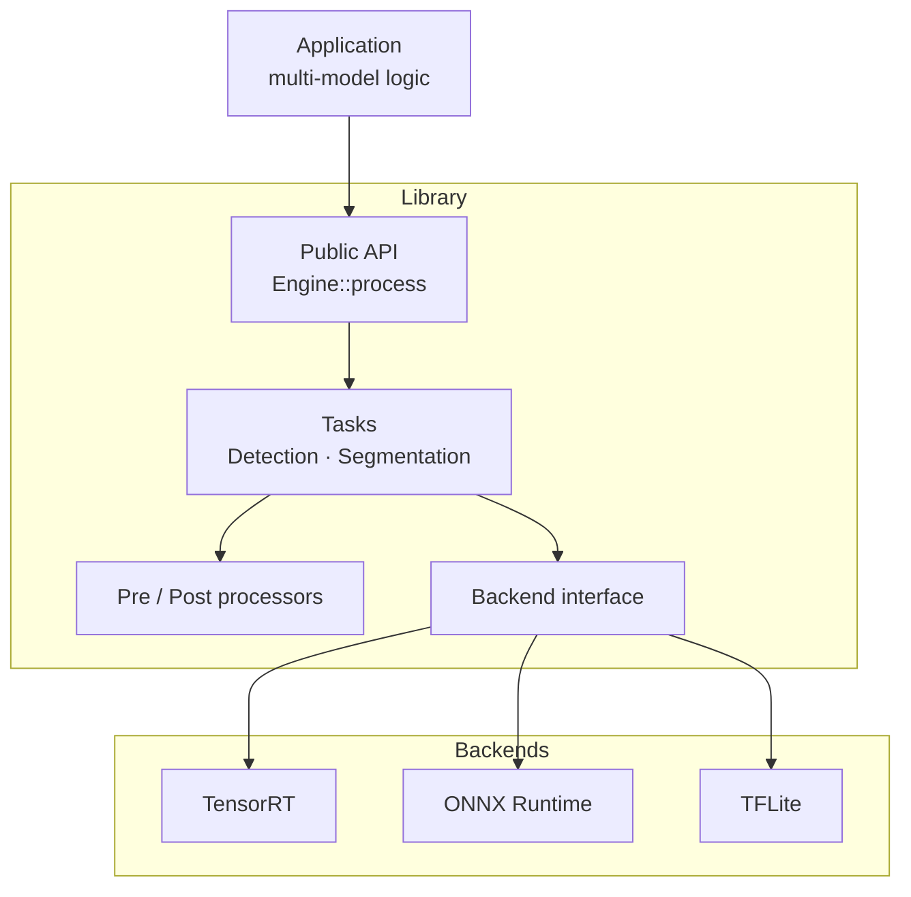
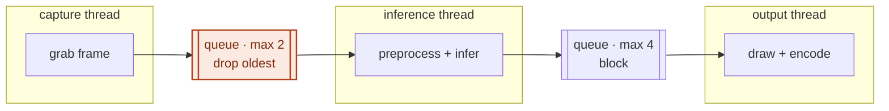
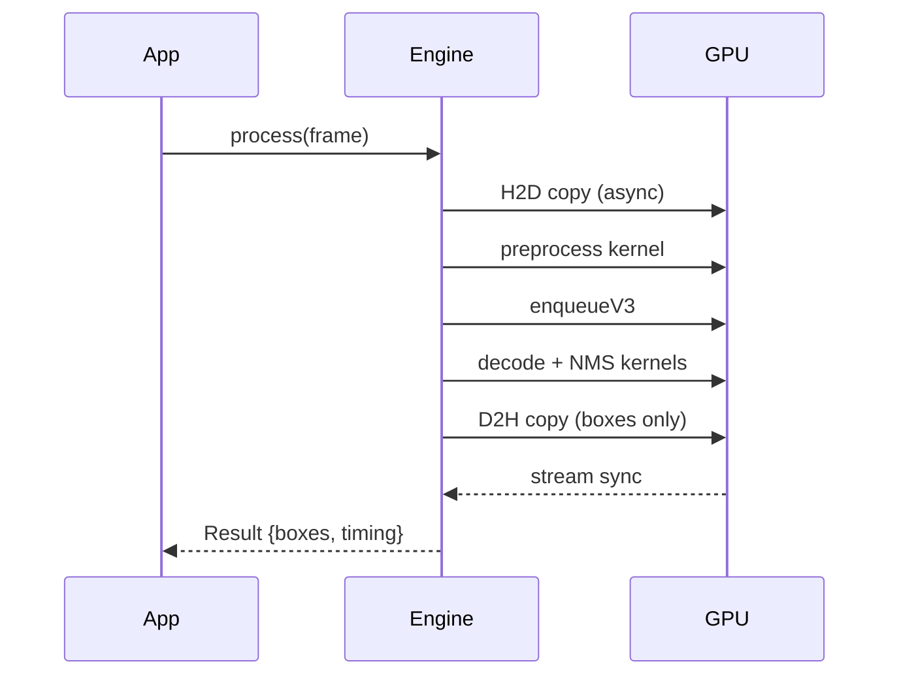
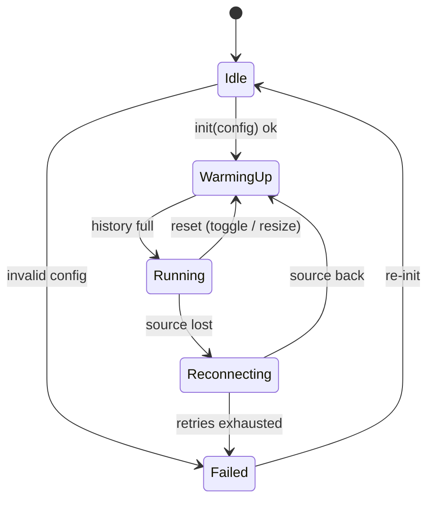
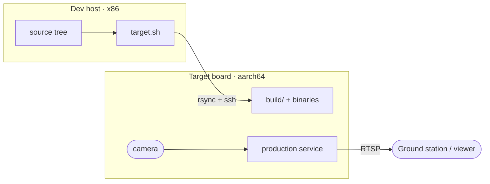
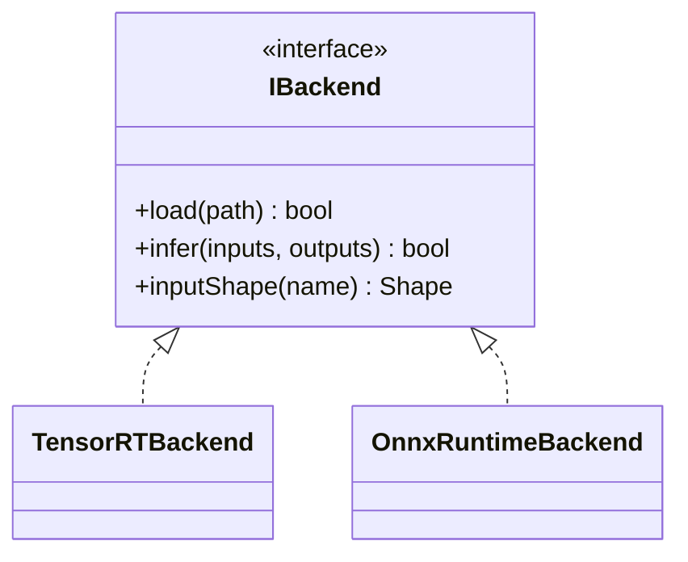

# Diagram patterns for embedded / edge systems

Start from the pattern that matches the question, then replace every name with the real token from the code (class, stage, config key, element name). All snippets render with `scripts/render.sh`.

Default look: **white page, soft tinted boxes** — see [style.md](style.md) for the palette and rules. Add only the `classDef`s you use:

```
classDef start fill:#1F2A37,stroke:#12181F,color:#FFFFFF,stroke-width:2px
classDef purple fill:#EFE7F7,stroke:#6A3D96,color:#4A2870,stroke-width:1.8px
classDef hot fill:#FBEAE2,stroke:#B0431C,color:#7E2E10,stroke-width:1.8px
classDef amber fill:#FAF0D9,stroke:#A0730B,color:#6E4E06,stroke-width:1.8px
classDef slate fill:#E8EEF2,stroke:#4A6070,color:#2C3E4C,stroke-width:1.8px
classDef finish fill:#6A3D96,stroke:#4A2870,color:#FFFFFF,stroke-width:2px
```

## 1. Per-frame data flow (pipeline)

Question: *what happens to one frame, where does it live, what does each hop cost?* Edge labels carry format, resolution, memory type, and (optionally) time.

```mermaid
flowchart LR
  cam([Camera]):::start -->|"H.264 / RTSP"| dec[HW decoder]
  dec -->|"NV12 1920x1080<br/>device memory"| pre[Preprocess<br/>resize + normalize]
  pre -->|"FP16 NCHW 640x640"| infer[TensorRT engine]:::hot
  infer -->|"raw boxes"| post[Decode + NMS]
  post -->|"≤100 boxes<br/>host copy"| app([Application]):::finish

  classDef start fill:#1F2A37,stroke:#12181F,color:#FFFFFF,stroke-width:2px
  classDef purple fill:#EFE7F7,stroke:#6A3D96,color:#4A2870,stroke-width:1.8px
  classDef hot fill:#FBEAE2,stroke:#B0431C,color:#7E2E10,stroke-width:1.8px
  classDef finish fill:#6A3D96,stroke:#4A2870,color:#FFFFFF,stroke-width:2px
```



## 2. Layered architecture

Question: *what are the layers and which way do dependencies point?* One box per layer or component, top to bottom, arrows pointing down only.



## 3. Threads and queues

Question: *which thread does what, where can frames pile up, what gets dropped?* Queues are nodes, labelled with size and policy.



## 4. Sequence — host, library, device

Question: *who calls whom, in what order, where are the syncs?* Keep to one scenario (init, steady-state frame, or error path).



## 5. State machine

Question: *what states exist and what moves between them?* Include the failure and recovery edges — they are usually why the diagram is needed.



## 6. Deployment

Question: *what runs where, and how do the machines talk?*



## 7. Latency budget

Question: *where does the frame time go?* Use real measured numbers (p50 or p99 — say which). Mermaid's gantt needs dates; use `dateFormat x` with millisecond offsets.

```mermaid
gantt
  title Frame budget 33 ms (p99)
  dateFormat x
  axisFormat %L ms
  section Capture
  decode        :0, 4
  section GPU
  preprocess    :4, 6
  inference     :6, 18
  postprocess   :18, 20
  section Host
  tracking      :20, 23
  encode + send :23, 30
```



## 8. Interfaces (class diagram)

Question: *what must a new backend/stage implement?* Interfaces and one or two implementations only — never every class.


